<div align="center">

# 🛡️ AIVM — AI-Driven Vulnerability Management System

**An intelligent security orchestration platform that pairs automated vulnerability scanning with AI-powered analysis to discover, prioritize, and remediate API threats.**

[](#-license)
[]()
[]()
[]()
[]()
[]()
[]()

[Overview](#-overview) •
[Architecture](#-system-architecture) •
[Features](#-key-features) •
[Tech Stack](#-technology-stack) •
[Screenshots](#-screenshots--walkthrough) •
[Deployment](#-deployment--access) •
[Testing](#-testing--quality-assurance) •
[Roadmap](#-roadmap) •
[Team](#-team--acknowledgments) •
[License](#-license)

</div>

---

## 📌 Overview

The rapid adoption of API-driven architectures has dramatically expanded modern attack surfaces. Today, most security teams still rely on a fragmented, manual six-step workflow:

> **Run Scans** ➔ **Collect Results** ➔ **Validate & Prioritize** ➔ **Map to Assets** ➔ **Write Reports** ➔ **Track & Re-test**

Doing this manually leads to three daily bottlenecks: **hours wasted parsing noisy logs**, **alert fatigue from false positives**, and **a lack of business context** that makes every alert look equally urgent.

**AIVM** compresses this six-step pipeline into a single automated workflow. It sits between raw open-source security scanners and your engineering team—normalizing heterogeneous scan outputs into a unified schema and applying a **Large Language Model (LLM)** to perform contextual risk analysis and generate ready-to-use code fixes.

### Core Objectives
* 🕒 **Eliminate Manual Triage:** Automatically parse messy scanner logs into clean, human-readable summaries.
* 🧠 **Prioritize Real Risk:** Use AI reasoning to filter out false positives and highlight vulnerabilities that actually impact business assets.
* ⚡ **Accelerate Remediation:** Shrink fix times from weeks to minutes by generating copy-pasteable, context-aware code patches.

> [!IMPORTANT]
> **Closed-Source Notice:** This codebase is currently private while the team transitions AIVM into a commercial SaaS product. See [Deployment & Access](#-deployment--access) and [License](#-license) for details.

---

### How AIVM Solves the Traditional Scanner Gap

| Traditional Bottleneck | Why It Hurts Teams | How AIVM Solves It |
| :--- | :--- | :--- |
| **🧩 Context-Free Alerts** | Scanners detect flaws in isolation without understanding business impact. | **AI-Enriched Intelligence:** Dual-model LLM reasoning evaluates real exploitability and business risk. |
| **📑 Duplicate Noise** | Multiple tools report the same flaw separately, inflating triage queues. | **Fingerprint Deduplication:** SHA-256 hashing consolidates duplicate findings and tracks regressions across scans. |
| **🛠️ Zero Fix Guidance** | Tools tell you *what* is broken, never *how* to patch it in your stack. | **Automated Patch Generation:** Generates exact, copy-pasteable code fixes tailored to the vulnerability. |
| **📉 Flat Prioritization** | Generic CVSS scores ignore asset criticality and organizational context. | **Contextual Scoring:** Weighs confidence scores alongside workspace and asset boundaries. |
| **🐢 Slow Feedback Loops** | Waiting for batch reports delays remediation and verification. | **Live Telemetry:** Real-time WebSocket streaming tracks scans from execution to verification. |

---

### Vulnerability Scope (MVP)

AIVM targets six high-impact vulnerability classes aligned with the **OWASP API Security Top 10**:

| Vulnerability Class | Engine / Tooling | Detection Capability |
| :--- | :--- | :--- |
| **💉 SQL Injection (SQLi)** | [Ghauri](https://github.com/r0oth3x49/ghauri) | Unauthorized database query execution via parameterized endpoints |
| **🧬 Cross-Site Scripting (XSS)** | [Dalfox](https://github.com/hahwul/dalfox) | Reflected, stored, and DOM-based payload injection |
| **🌐 Server-Side Request Forgery (SSRF)** | Custom Probes | Unauthorized internal network requests and cloud metadata access |
| **📂 Local File Inclusion (LFI)** | `lfimap`, `dotdotpwn` | Path traversal and unauthorized file system reads |
| **🧩 Server-Side Template Injection (SSTI)** | Mathematical Probes | Arbitrary code execution inside server-side template engines |
| **🔓 Sensitive Data Exposure** | Signature Matching | Leaked API keys, credentials, and PII in HTTP responses |

---

## 🏗 System Architecture

AIVM is engineered around **four decoupled architectural pillars**, allowing each layer to scale and deploy independently:

| Pillar | Stack | Core Responsibilities |
| :--- | :--- | :--- |
| **🎨 Presentation** | React (Vite) | SPA dashboard, live scan progress views, interactive exploit graphs |
| **⚙️ Application** | ASP.NET Core | REST API, Clean Architecture business logic, RBAC, scan orchestration |
| **🔬 Security Execution** | Python (FastAPI) | Isolated Docker scanner execution and raw output normalization |
| **🧠 AI Intelligence** | Node.js | LLM inference, dual-model fallback, JSON schema validation |

### High-Level System Diagram

<p align="center">
  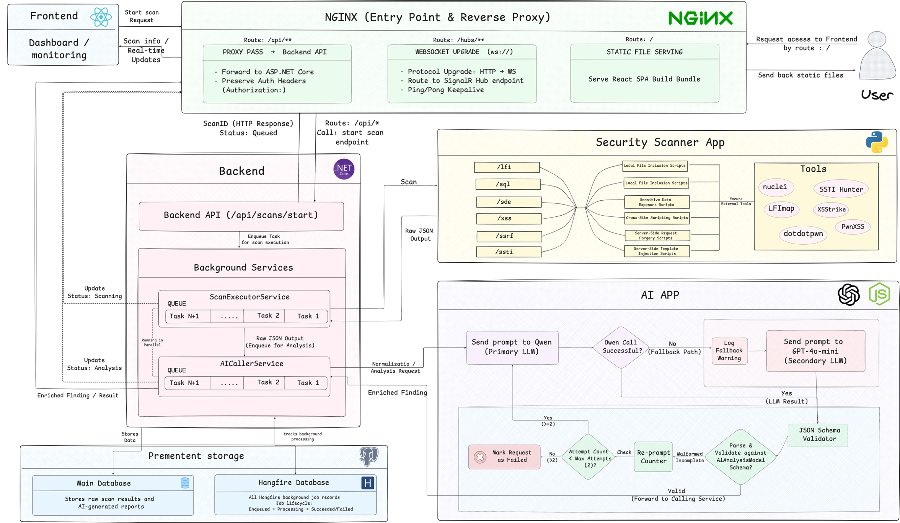
</p>

### Scan Orchestration Lifecycle

1. **Request & Queue:** The API validates the scan target, returns `202 Accepted` with a tracking URI, and queues a persistent **Hangfire** background job (`Pending`).
2. **Execution:** `ScanExecutorService` invokes the FastAPI Scanner service (`Running`), spinning up isolated ephemeral containers for each selected tool.
3. **Live Streaming:** Real-time execution logs and progress events stream to the React client via **SignalR** WebSockets.
4. **Normalization & AI Analysis:** Raw scanner outputs are normalized into a unified schema and sent to the Node.js AI Engine for severity scoring, root-cause explanation, and patch generation.
5. **Persistence & Alerting:** Deduplicated findings are saved to PostgreSQL (`Completed`), triggering instant UI updates and optional email notifications.

<p align="center">
  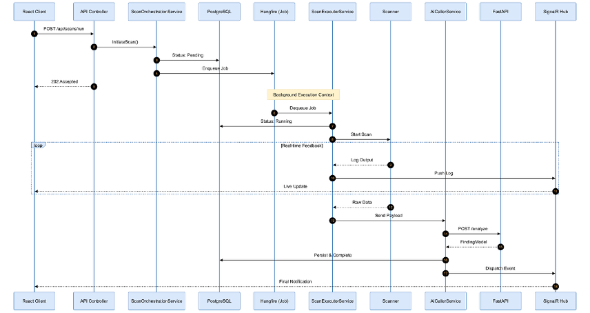
</p>

### Database Architecture

The PostgreSQL schema spans **37 tables across 14 logical domains**, built with UUID primary keys, soft deletes, SHA-256 finding fingerprints, and `JSONB` columns for flexible AI payloads.

| Domain | Key Tables | Purpose |
| :--- | :--- | :--- |
| **Multi-Tenancy** | `organizations` | Root tenant boundary, subscription limits, data isolation |
| **Identity & Auth** | `users`, `organization_members`, `access_tokens` | User accounts, memberships, JWT refresh lifecycle |
| **Access Control** | `roles`, `permissions`, `role_permissions` | Data-driven, organization-scoped RBAC |
| **Asset Inventory** | `projects`, `assets`, `targets` | Hierarchical organization of scannable endpoints |
| **Scan Engine** | `scans`, `scan_tasks`, `tool_executions` | Execution state, worker tracking, tool telemetry |
| **Findings** | `findings`, `finding_history`, `finding_evidence` | Deduplicated vulnerabilities, audit trails, raw proofs |
| **AI Pipeline** | `ai_analysis_jobs`, `ai_analysis_results`, `ai_prompt_logs` | LLM job tracking, structured outputs, token observability |
| **Governance** | `audit_logs`, `authentication_events`, `reports` | Compliance logging and expiring PDF/CSV exports |

<p align="center">
  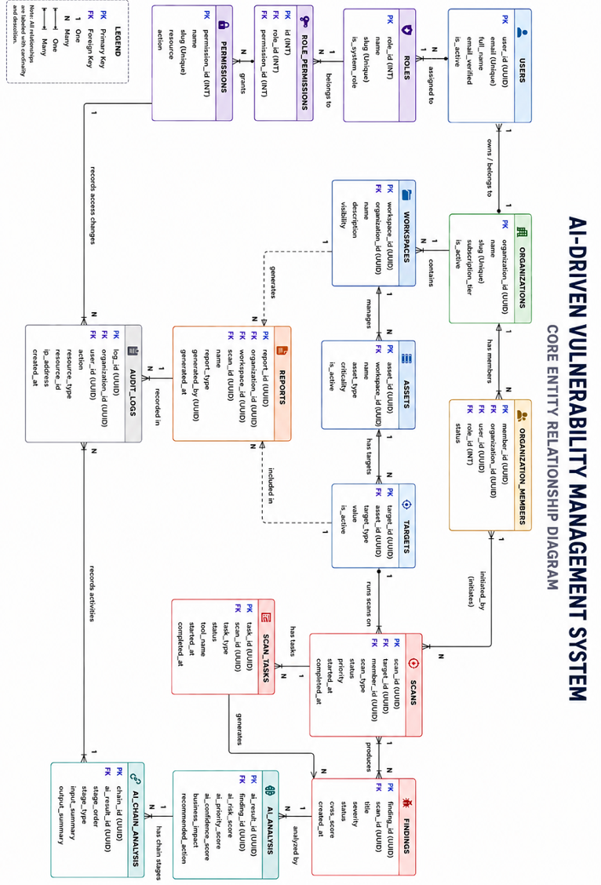
</p>

---

## ✨ Key Features

* **🔍 Parallel Multi-Class Scanning:** Runs SQLi, XSS, SSRF, LFI, SSTI, and Data Exposure checks concurrently inside isolated Docker containers.
* **🤖 Contextual AI Enrichment:** Generates plain-English explanations, root-cause breakdowns, business impact assessments, and confidence-scored severities.
* **🔁 Dual-Model AI with Automatic Fallback:** Routes inference through [Qwen](https://github.com/QwenLM/Qwen) (primary) with automatic failover to **GPT-4o-mini** via [OpenRouter](https://openrouter.ai/) during rate limits or degradation.
* **✅ Self-Healing Output Validation:** Enforces strict JSON schemas on LLM responses—automatically re-prompting on malformed output to prevent pipeline failures.
* **⚡ Sub-100ms Real-Time Telemetry:** Streams scan status and live findings directly to the browser over SignalR WebSockets.
* **🏢 Strict Multi-Tenancy & RBAC:** Enforces workspace isolation across `Organizations ➔ Workspaces ➔ Assets ➔ Targets` at both the API and database layers.
* **🧱 Fault-Tolerant Tool Isolation:** Ephemeral containers ensure a crashing scanner tool never corrupts host state or produces a false "clean" scan.
* **🧩 SHA-256 Deduplication:** Prevents alert fatigue across recurring scans and automatically re-opens resolved vulnerabilities if they regress.
* **📊 Executive & Developer Reporting:** Exports clean PDF and CSV reports complete with severity metrics and step-by-step code remediation.

---

## 🧰 Technology Stack

| Layer | Technology | Role |
| :--- | :--- | :--- |
| **Frontend** | React.js (Vite) | Real-time SPA dashboard |
| **Backend API** | ASP.NET Core (Clean Architecture) | Orchestration, RBAC, business logic |
| **Scanner Engine** | Python (FastAPI) | Containerized tool execution & normalization |
| **AI Service** | Node.js | LLM routing, schema validation |
| **Database** | PostgreSQL 14+ | Primary relational store & Hangfire persistence |
| **Cache / Pub-Sub** | Redis 7 | Ephemeral scan state & real-time event bus |
| **Background Jobs** | Hangfire | Reliable asynchronous job processing |
| **Real-Time** | SignalR | Bidirectional WebSocket telemetry |
| **Gateway** | Nginx | Reverse proxy, SSL termination, single ingress |
| **Infrastructure** | Docker & Docker Compose | Multi-container orchestration |
| **AI Models** | Qwen + GPT-4o-mini (OpenRouter) | Primary/fallback LLM inference |
| **Observability** | Serilog | Structured logging with correlation IDs |
| **QA & DevOps** | k6, xUnit, GitHub Actions | Load testing, unit/integration suites, CI/CD |
| **Graph Engine** *(Planned)* | Cytoscape.js + NetworkX | Interactive multi-step exploit-chain graphs |
| **RAG Engine** *(Planned)* | FAISS + Sentence-Transformers | Historical context grounding for AI |

---

## 🖼 Screenshots & Walkthrough

### Workspace Dashboard
<p align="center">
  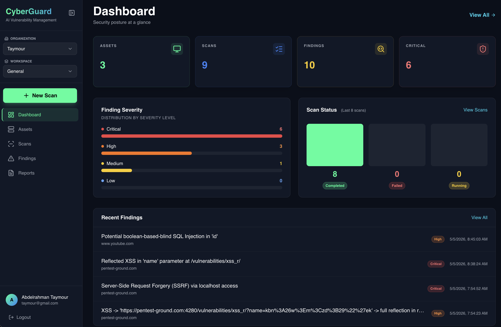
  <br><em>Organization security posture, severity distribution, and recent scan activity at a glance.</em>
</p>

<details>
<summary><strong>📸 Click to expand Scanning Workflow screenshots (5 images)</strong></summary>
<br>

<p align="center">
  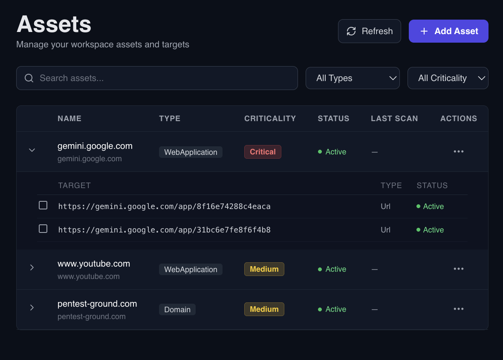
  <br><em>Asset &amp; Target Management</em>
</p>

<p align="center">
  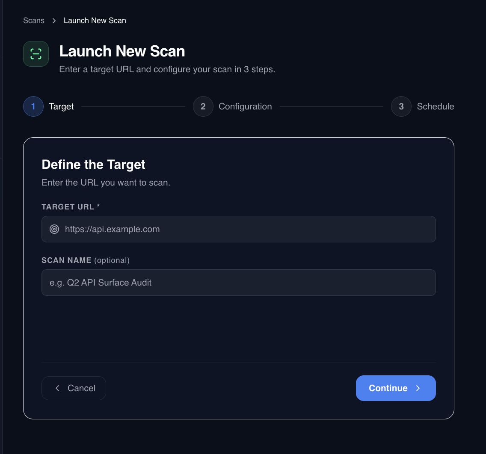
  <br><em>Launch Scan — Step 1: Target Configuration</em>
</p>

<p align="center">
  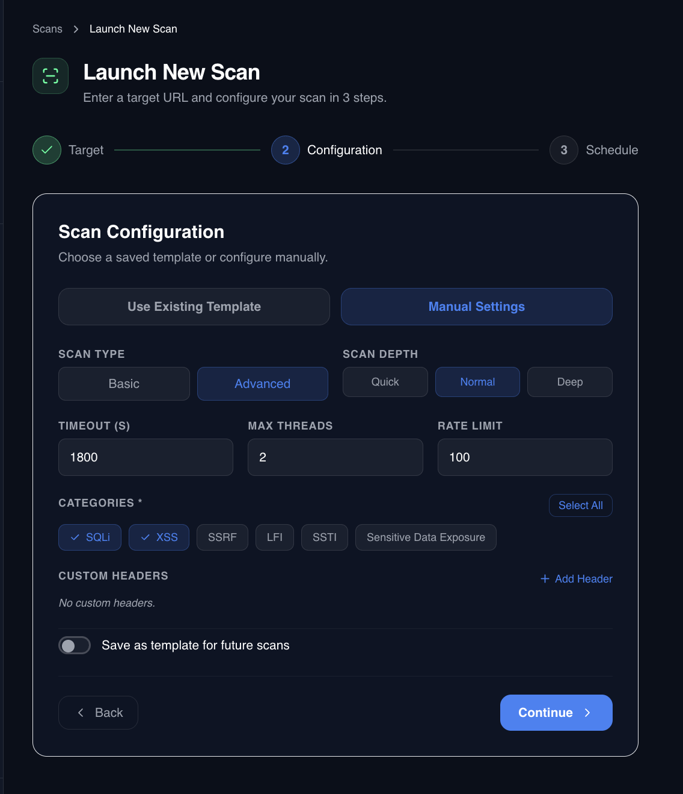
  <br><em>Launch Scan — Step 2: Vulnerability Class &amp; Intensity Settings</em>
</p>

<p align="center">
  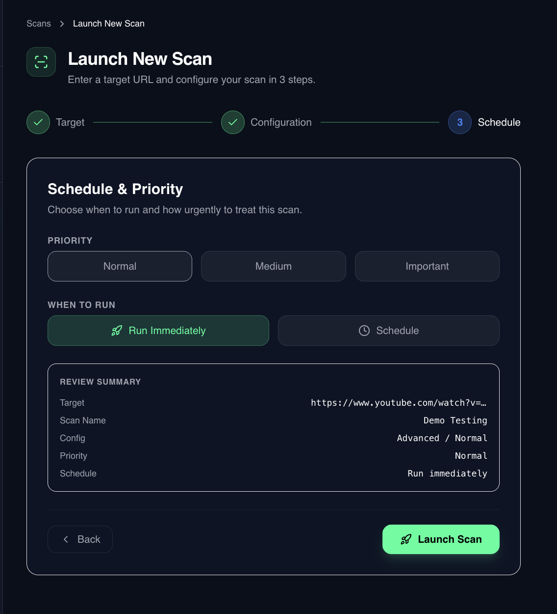
  <br><em>Launch Scan — Step 3: Review &amp; Launch</em>
</p>

<p align="center">
  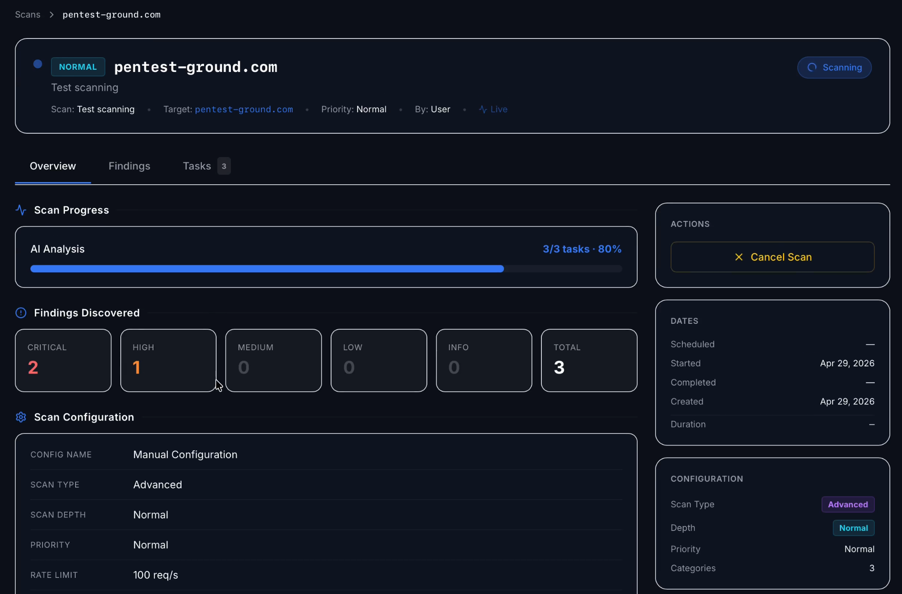
  <br><em>Live Scan Telemetry — Real-time execution progress streamed via SignalR</em>
</p>

</details>

<details>
<summary><strong>📸 Click to expand Scan Results & AI Findings screenshots (5 images)</strong></summary>
<br>

<p align="center">
  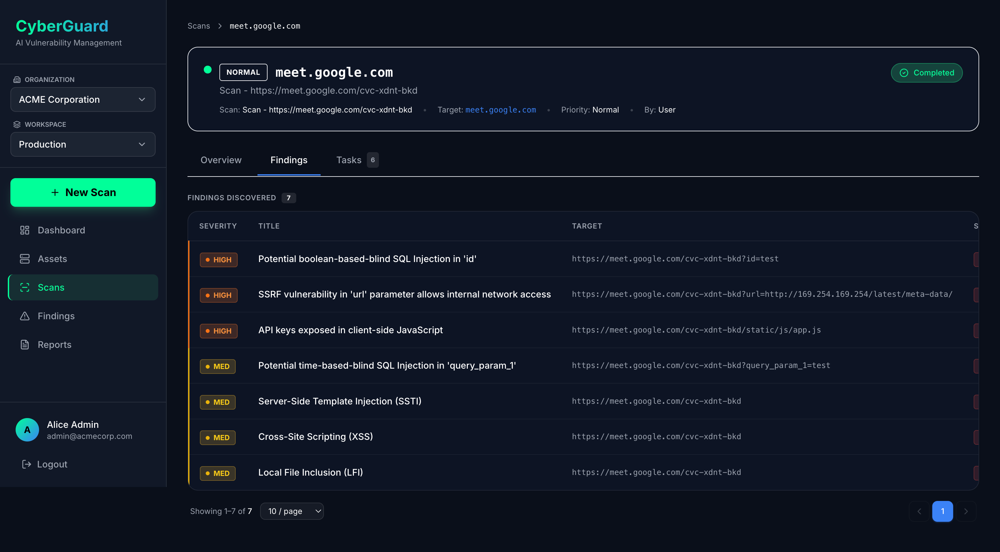
  <br><em>Scan Detail — Prioritized Vulnerability Findings</em>
</p>

<p align="center">
  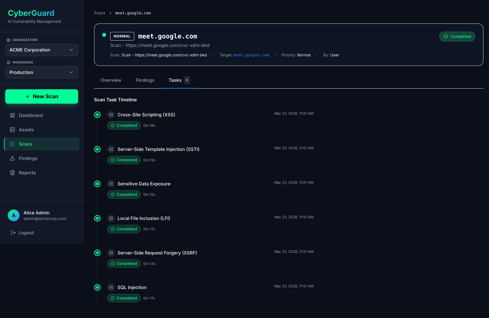
  <br><em>Scan Detail — Individual Tool Execution Tasks</em>
</p>

<p align="center">
  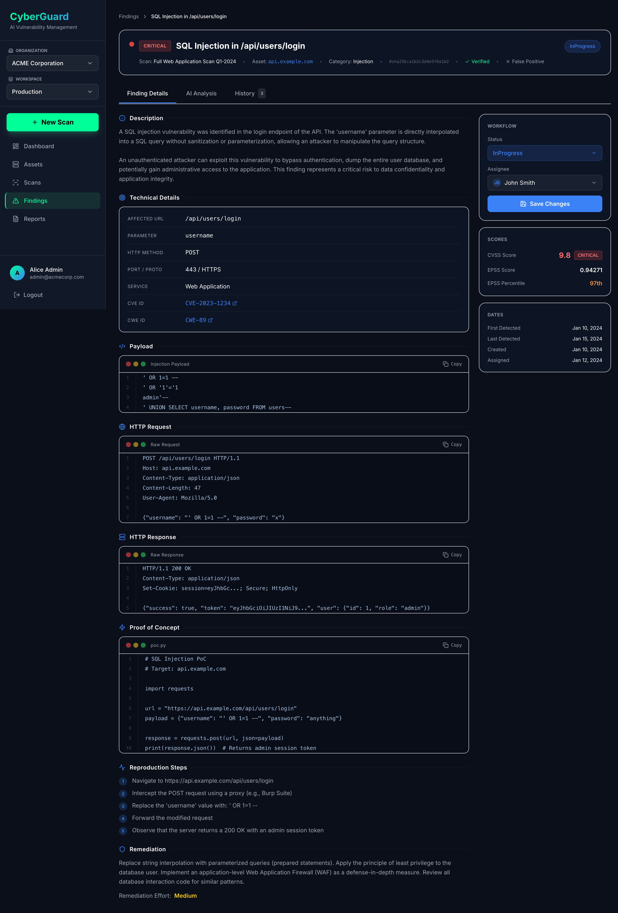
  <br><em>Finding Detail — Technical Evidence &amp; Metadata</em>
</p>

<p align="center">
  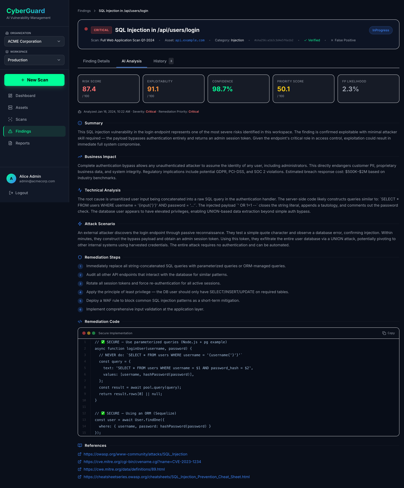
  <br><em>Finding Detail — AI Root-Cause Analysis &amp; Code Remediation</em>
</p>

<p align="center">
  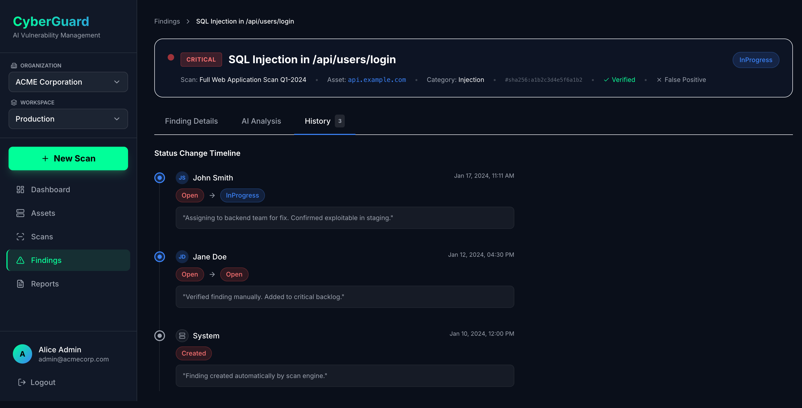
  <br><em>Finding Detail — Full Lifecycle &amp; Audit History</em>
</p>

</details>

---

## 🚀 Deployment & Access

Because AIVM is a **closed-source commercial candidate**, public cloning and self-hosting instructions are intentionally omitted. Source code and staging environments are restricted to authorized team members and collaborators.

### Internal Infrastructure Architecture
For internal testing and staging, the platform runs as an isolated **Docker Compose** stack:
* **Single Ingress:** **Nginx** acts as the sole public entry point; all backend microservices communicate over an internal bridge network.
* **Gated Startup:** A dedicated `db-init` container executes versioned SQL migrations (`001`–`003`), blocking dependent services until PostgreSQL passes health checks.
* **Secret Management:** Database credentials, JWT signing keys, SMTP configs, and OpenRouter API keys are injected at runtime via an untracked `.env` file.
* **Environment Controls:** Internal staging builds (`ASPNETCORE_ENVIRONMENT=Staging`) restrict Swagger UI and the Hangfire dashboard exclusively to the internal VPN/network.

> [!NOTE]
> Authorized team members can find full `.env` schemas and deployment runbooks in the internal `aivm-infra` repository.

---

## 📁 Monorepo & Repository Structure

The codebase is organized into domain-aligned microservices across private repositories:

| Repository | Pillar | Description |
| :--- | :--- | :--- |
| `aivm-frontend` | Presentation | React (Vite) SPA dashboard |
| `aivm-backend` | Application | ASP.NET Core API, orchestration, RBAC |
| `aivm-scanner-api` | Security Execution | Python FastAPI scanner orchestration service |
| `aivm-ai-engine` | AI/ML Intelligence | Node.js LLM inference & schema validation service |
| `aivm-infra` | Infrastructure | Docker Compose, Nginx, deployment configs |

### Local Compose Layout

```text
aivm/
├── nginx/
│   └── nginx.conf               # Reverse proxy & routing rules
├── scripts/
│   └── run-migrations.sh        # Automated SQL migration runner
├── backend/
│   └── AIVM.Backend.API/        # .NET Core Web API (Application Pillar)
│       ├── Dockerfile
│       ├── appsettings.json
│       └── DB/                  # Versioned PostgreSQL initialization scripts
├── frontend/                    # React SPA (Presentation Pillar)
├── scanner/                     # Python FastAPI service (Security Execution Pillar)
├── ai-engine/                   # Node.js LLM service (AI Intelligence Pillar)
├── docker-compose.yml           # Full-stack orchestration
├── .env.template                # Safe environment variable template
└── .env                         # Local secrets (gitignored)

```

---

## 🧪 Testing & Quality Assurance

Quality gates are enforced automatically on every pull request via **GitHub Actions** across five testing tiers:

| Test Tier | Tooling | Key Benchmark / Result |
| --- | --- | --- |
| **Unit Testing** | xUnit + Moq | **82–94%** code coverage across core application services |
| **Integration Testing** | Dockerized PostgreSQL | **100%** pass rate across API ➔ Service ➔ DB transaction paths |
| **Load & Performance** | Grafana k6 | **670% throughput gain** after connection-pool tuning (failure rate cut from `13.6%` to `~2%` at 500 VUs) |
| **Security Validation** | Custom Suite | Verified SSRF defenses, strict input sanitization, and JWT rotation |
| **CI/CD Automation** | GitHub Actions | Automated builds, test runs, and container health checks on push |

---

## 🗺 Roadmap

* [x] **MVP Core:** Parallel scanning across 6 OWASP API vulnerability classes
* [x] **AI Pipeline:** Dual-model LLM enrichment with automatic OpenRouter fallback
* [x] **Enterprise Foundations:** Multi-tenant RBAC and real-time SignalR dashboard
* [ ] **RAG Knowledge Base** *(Next Priority)* — Ground AI remediation in historical scan context using **FAISS** & **Sentence-Transformers**
* [ ] **Exploit-Chain Analysis** — Visualize multi-step attack paths using **NetworkX** & **Cytoscape.js**
* [ ] **Expanded Scanner Coverage** — Add automated checks for **IDOR**, **XXE**, **JWT flaws**, and **GraphQL** misconfigurations
* [ ] **DevSecOps Integrations** — Native GitHub Actions / GitLab CI triggers for automated PR security gates
* [ ] **Cloud-Native Scaling** — Kubernetes Helm charts for elastic scanner worker autoscaling
* [ ] **Commercial SaaS Launch** — Self-service onboarding, billing, and public cloud availability

---
## 👥 Team & Acknowledgments

Originally developed as a Computer Science graduation project at **El Shorouk Academy** and actively evolving into a commercial security platform.

* **Project Supervisor:** Dr. Mohammed Saqr
* **Assisting Supervisor:** Eng. Ahmed Mahfouz

### Core Team
* **Abdelrahman Taymour** — *Full-Stack Software Engineer*
* **Mohammed Alsaeed** — *Backend Engineer*
* **Omar Tantawy** — *Frontend Engineer*

### Security Team
* **Mahmoud Samir**
* **Mostafa Bekhit**
* **Eslam Khaled**

### AI / ML Team
* **Medat Kamel**
* **Ziad Mohamed**

*We extend our sincere gratitude to our faculty advisors, families, and peers for their continuous guidance and support.*
---

## 📄 License

**All Rights Reserved — Proprietary and Confidential.**

Copyright © 2026 **AIVM Team**. All rights reserved.

This software—including its source code, system architecture, AI prompts, datasets, and documentation—is the exclusive proprietary property of the AIVM Team. No part of this project may be copied, modified, distributed, sublicensed, or used commercially without prior written permission from the authors.

> **Why Proprietary?** Unlike open-source tools (MIT/Apache/GPL), AIVM is actively transitioning into a commercial SaaS product. Keeping the codebase closed-source protects our intellectual property during commercialization. For licensing, partnership, or academic inquiries, please contact the team directly.

---

**AIVM** — *Because raw vulnerability scans shouldn't be the final answer.*
